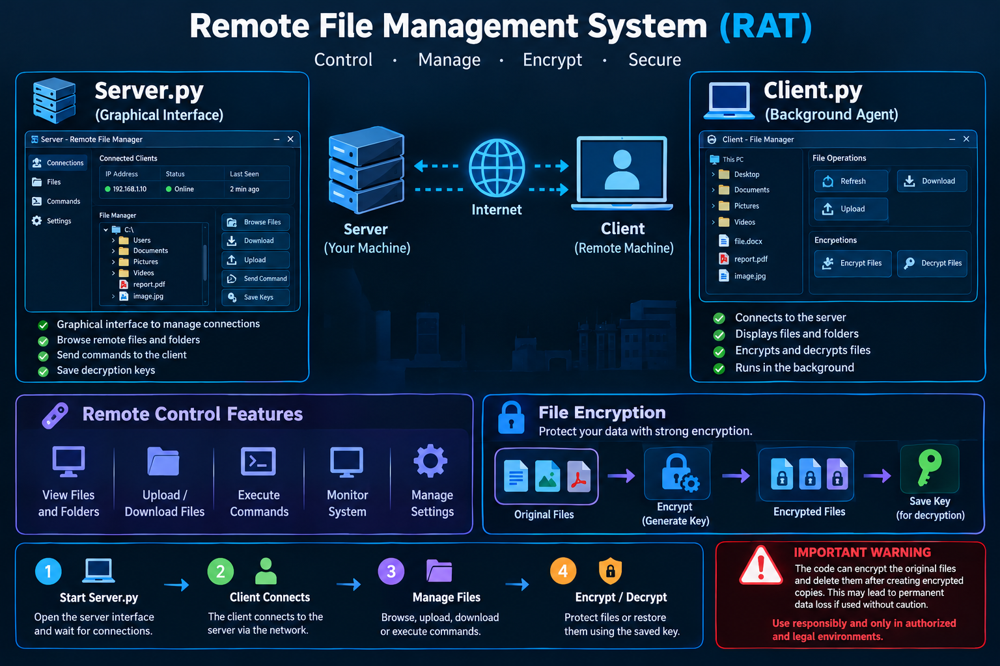

import os, zipfile, shutil
from pathlib import Path

outdir = Path("/mnt/data/rat_security_review_github")
(outdir / "docs" / "images").mkdir(parents=True, exist_ok=True)

readme = r"""# 🔐 Remote Access Trojan (RAT) — Security Review Lab

<p align="center">
  
</p>

<p align="center">
  <strong>Defensive Code Review • Threat Analysis • Safe Malware Research</strong>
  <br>
  Python • HTTP • Fernet Cryptography • Tkinter
</p>

<p align="center">
  
  
  
</p>

---

## ⚠️ Safety Notice

This repository documents a Python client/server sample whose behavior includes remote command delivery, directory browsing, and file encryption/decryption. These capabilities can cause data loss or enable unauthorized access.

**Do not run this code on a personal, production, or third-party system.** This README is intended for defensive code review, threat modeling, and incident-response learning. It deliberately does not provide deployment instructions or operational command sequences.

## 🔎 Project Overview

The supplied code contains two main components:

- **Client (`Client.py`)** — initiates HTTP communication, reports directory listings, receives server-provided commands, and contains file encryption/decryption routines.
- **Server (`Server.py`)** — exposes an HTTP listener and a Tkinter GUI for tracking connected client identifiers, viewing activity logs, and queuing commands.

The current implementation should be treated as potentially harmful software, not as a secure remote administration tool.

## 🧩 High-Level Architecture

```text
             CLIENT HOST
     ┌─────────────────────────┐
     │ Client.py               │
     │ • HTTP polling          │
     │ • Directory enumeration │
     │ • File operations       │
     └────────────┬────────────┘
                  │ HTTP
                  │ No transport TLS
                  ▼
     ┌─────────────────────────┐
     │ Server.py               │
     │ • HTTP listener         │
     │ • Client tracking       │
     │ • Command queue         │
     │ • Activity GUI / logs   │
     └─────────────────────────┘

       Defensive review boundary:
       isolated lab + no real data
```

## 🛡️ Security Findings

| Finding | Why it matters | Defensive recommendation |
|---|---|---|
| Plain HTTP transport | Commands, responses, and encryption keys may be exposed or altered in transit. | Do not expose the service; use authenticated, encrypted protocols in legitimate administration software. |
| No strong client authentication | A UUID header is an identifier, not proof of identity. | Require mutually authenticated clients and server-side authorization. |
| Destructive file handling | The client writes an encrypted copy and then attempts to delete the original. | Remove destructive behavior from demonstrations; use disposable test fixtures and non-destructive simulations. |
| Key material written to a local text file | Stored keys can be disclosed or misused if the server host is compromised. | Never log secrets; use a managed secret store and strict access controls. |
| Broad filesystem access | The client operates relative to the current user profile and can enumerate files. | Apply explicit directory allowlists and least-privilege permissions. |
| Unrestricted command queue | The server can issue file-operation commands to connected clients. | Use a fixed allowlist of harmless actions, signed requests, authorization, and audit trails. |
| No robust integrity or replay protection | Requests may be spoofed or replayed. | Add authenticated messages, timestamps/nonces, and replay detection. |
| Listener binds to all interfaces | The service may be reachable from other hosts depending on firewall and network configuration. | Keep analysis isolated and bind services only to a controlled interface when building benign tools. |

## 🧪 Safe Analysis Workflow

1. Review the source code statically before executing anything.
2. Use an isolated, disposable virtual machine with snapshots if dynamic analysis is authorized.
3. Disconnect the lab from production networks and block outbound access.
4. Use synthetic files only; never use personal or business data.
5. Record observed network requests, filesystem changes, and process behavior.
6. Revert the VM snapshot after analysis and securely remove test artifacts.

## 🧰 Technologies Observed

- **Python** — application logic
- **Requests** — HTTP client communication
- **`http.server`** — basic HTTP server
- **Tkinter** — desktop GUI
- **Fernet (`cryptography`)** — symmetric authenticated encryption

## 📁 Source Layout

```text
repository/
├── README.md
├── Client.py
├── Server.py
└── docs/
    └── images/
        └── banner.png
```

This layout describes the supplied files and the documentation assets; it does not imply that the code is safe to execute.

## 🚑 Incident-Response Notes

If you discover this software running without authorization:

- Isolate the affected host from the network.
- Preserve relevant logs and evidence before making changes.
- Identify files with unexpected `.enc` extensions and determine whether original files remain available.
- Do not assume that a saved key file is trustworthy or that decryption will succeed.
- Restore from verified offline backups where necessary.
- Follow your organization's incident-response process and involve qualified security personnel.

## 🚀 Safe Future Direction

For a portfolio-ready defensive project, replace remote command execution and destructive file operations with:

- A **read-only telemetry simulator** that uses synthetic events.
- A local dashboard showing mock clients and harmless event logs.
- A ransomware-behavior detector that flags suspicious mass file modifications.
- A test harness that encrypts only in-memory sample strings or temporary generated fixtures, without deleting originals.
- Unit tests and documented detection rules.

## 👨‍💻 Author

**David Hany**  
Computer Science & Artificial Intelligence • Cybersecurity

GitHub: [@davidhany10](https://github.com/davidhany10)

---

<p align="center">
  <strong>Analyze Safely • Detect Threats • Protect Systems</strong>
</p>
"""

(outdir / "README.md").write_text(readme, encoding="utf-8")

# Use the safe, defensive-analysis banner generated for this documentation bundle.
# The generated image file is copied only if the exact path exists.
source_image = Path("/mnt/data/a_clean_dark_cyberpunk_themed_project_readme_post.png")
if source_image.exists():
    shutil.copy2(source_image, outdir / "docs" / "images" / "banner.png")
else:
    # A text-only placeholder avoids inventing an image path or leaving a broken asset unnoticed.
    (outdir / "docs" / "images" / "IMAGE_PLACEHOLDER.txt").write_text(
        "Place your approved defensive-security banner here as banner.png.\n",
        encoding="utf-8"
    )

zip_path = Path("/mnt/data/rat_security_review_github.zip")
with zipfile.ZipFile(zip_path, "w", compression=zipfile.ZIP_DEFLATED) as zf:
    for p in outdir.rglob("*"):
        if p.is_file():
            zf.write(p, p.relative_to(outdir.parent))

text = f"Created {zip_path}\nREADME: {outdir / 'README.md'}\nFiles: " + ", ".join(str(p.relative_to(outdir)) for p in outdir.rglob("*") if p.is_file())
print(text)
